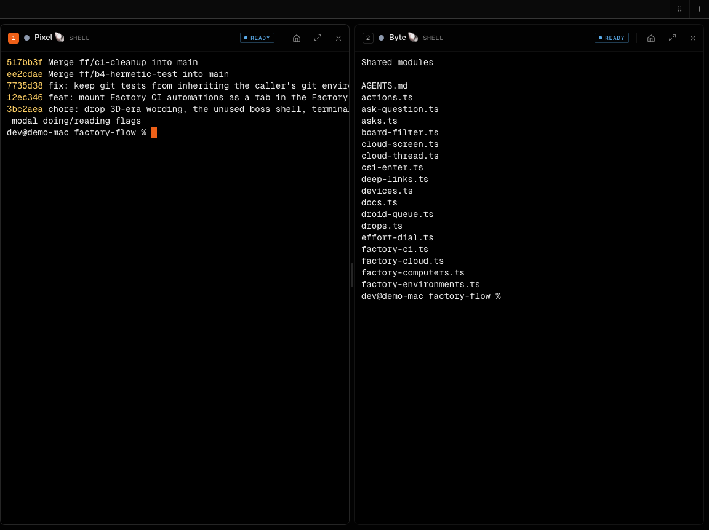
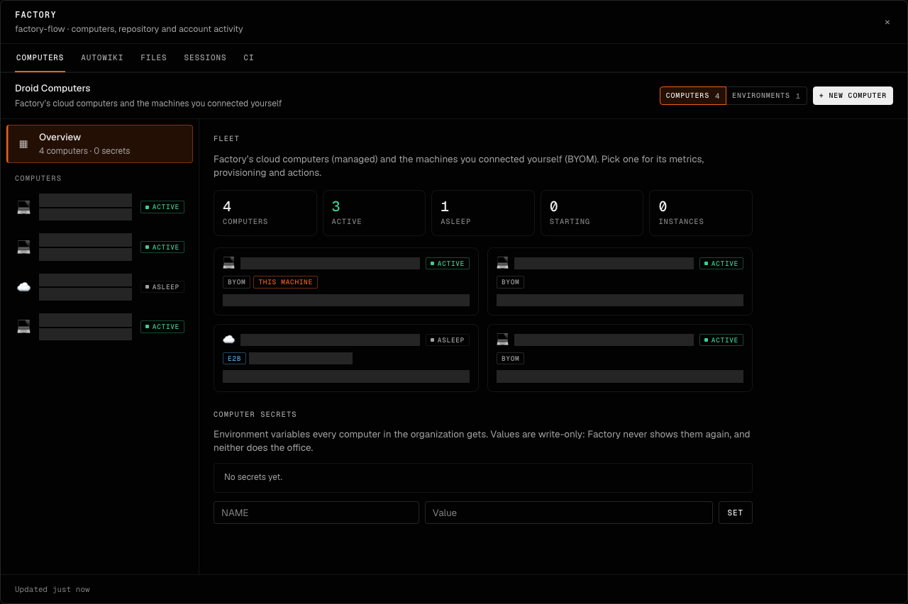
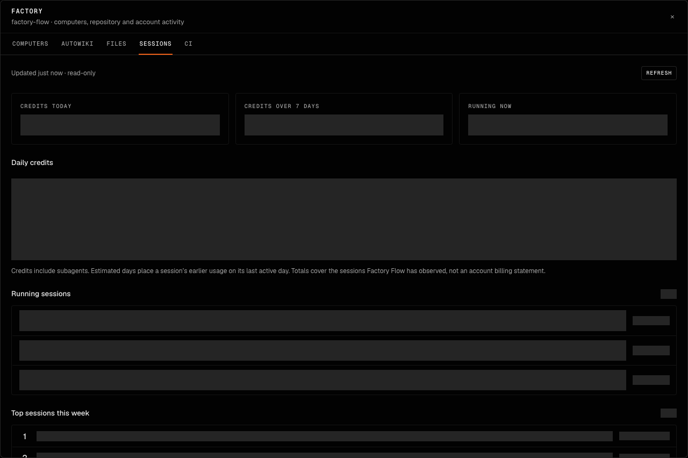

# Factory Flow

Hire Factory Droid workers and work in their live terminals from your Mac, browser or phone.

[Download](#download) · [Guide](docs/guide/README.md) · [MIT license](LICENSE)



Factory Flow is a local workspace for running many [Factory Droid](https://docs.factory.ai/cli/getting-started/quickstart) sessions at once. You hire workers on your own git checkouts, watch them in live terminals and conversation threads, answer their questions and review what they finish. Everything runs on your machine. There are no accounts, no chat and no shared state: it is for one owner.

## What you get

- **A workspace of up to eight panes.** Each pane shows one worker's conversation thread or its live terminal. Layouts grow and shrink as workers start, wait for you or finish.
- **A floor per project.** Each git checkout you already have is a floor with its own workers, boards and task queue. Workers can get isolated git worktrees, so they never trip over each other.
- **Teams and subagents.** Workers coordinate through Office MCP: they hire subagents, message each other, ask you questions and share artifacts.
- **Boards and pipelines.** GitHub and GitLab issues and pull requests, plus Linear and Jira tickets, sit one shortcut away. Hand a card to a worker or queue it as a task.
- **Mission Control.** The Orchestrator plans work across every floor, hires workers and reports back. External bots can reach it over Tailscale.
- **The Whiteboard.** Share Markdown, images and live pages with a worker, then mark them up and comment.
- **The Factory window.** Click the Factory glyph to see your Factory computers, AutoWiki, repository files, sessions and credit use in one place.
- **A phone companion.** The Android app pairs with your Mac over Tailscale and shows every worker, terminal and question.





Screenshots come from an isolated workspace. Gray blocks hide private account names and usage.

See [Features](docs/guide/features.md) for the full tour and [Controls](docs/guide/controls.md) for keyboard shortcuts.

## Download

The signed Mac app release is the only supported production install. Get both files from the [latest release](https://github.com/nikships/factory-flow/releases/latest):

- **Mac:** `Factory-Flow-<version>-arm64.dmg`. Open it and drag Factory Flow into Applications. It updates itself.
- **Android:** `Factory-Flow-<version>.apk`. See the [Android guide](docs/guide/android.md) for pairing.

The Mac app needs **macOS 14 or later on Apple silicon**. It opens the companion workspace in its own window. Closing the window leaves workers running behind the menu bar icon. You also need [`droid`](https://docs.factory.ai/cli/getting-started/quickstart), `git` and, for boards, `gh` or `glab`. The first-launch welcome installs and signs in Droid for you.

### Alongside Droid Office

Factory Flow and Droid Office can be installed together. Factory Flow has its own app identity (`com.nikships.factory-flow`), its own `factoryflow://` link scheme and keeps its state in `.factory-flow/` folders (`~/factory-flow` by default). It reads a project's legacy `.droid-office.json` only as a fallback when `.factory-flow.json` is absent; it does not write that legacy file. Factory Flow defaults to port 4700 and Droid Office to 4600. If Factory Flow's port is occupied, it takes the next free port.

## Develop

Requires Node.js 20+.

```sh
git clone https://github.com/nikships/factory-flow.git
cd factory-flow
npm ci
npm run dev
```

`npm run dev` serves the Vite client on `http://localhost:5173/dashboard` and proxies it to the watched server on port 4700. Before a pull request, run `npm run lint`, `npm run typecheck`, `npm run test:coverage` and `npm run build`. See [Development](docs/guide/development.md) for isolated verification and releases.

## Docs

- [Guide index](docs/guide/README.md)
- [Getting started](docs/guide/getting-started.md) and [How it works](docs/guide/how-it-works.md)
- [Android](docs/guide/android.md), [Remote workers](docs/guide/remote-workers.md) and [Security](docs/guide/security.md)
- Specs: [Factory](docs/factory.md), [Linear](docs/linear.md), [Whiteboard](docs/whiteboard.md), [Office MCP](docs/office-mcp.md), [Mission Control](docs/mission-control.md), [Subscriptions](docs/subscriptions.md), [Single owner](docs/single-owner.md)

## Credits

Factory Flow is forked from [Droid Office](https://github.com/nikships/droid-office), which began as a fork of [AgentSystemLabs/agent-office](https://github.com/AgentSystemLabs/agent-office). Thanks to both projects.

## License

[MIT](LICENSE)
